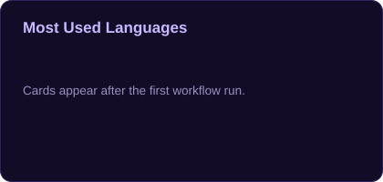

  

  
  
  

## 👨‍💻 About me

- 🎓 IT graduate, **Applied Science Private University (ASU)**, 2026
- 💼 Intern @ **Carseer**
- 🔭 Building a **distributed e-commerce order pipeline** (Orders · Inventory · Payments)
- 🌱 Learning **AWS**, **Docker** and CI/CD
- 🛡️ Into **cybersecurity** and CTF challenges
- 💬 Ask me about C#, ASP.NET Core, EF Core and Clean Architecture

## 🛠️ Tech stack

| Area | Tools |
|---|---|
| **Backend** |     |
| **Data** |    |
| **Cloud & DevOps** |     |
| **Tools** |     |
| **Security** |    |

## 🚀 Featured projects

| Project | What it does | Built with |
|---|---|---|
| 🛒 **Order Pipeline** | Distributed e-commerce order flow across Orders, Inventory and Payments services | C# · ASP.NET Core · Microservices |
| 🗂️ **Task Manager** | Trello-style boards → lists → cards, with auth and real-time sync | ASP.NET Core MVC · EF Core · Identity · SignalR |

## 📊 GitHub stats

  
  

  

⚡ Cards refresh daily via GitHub Actions

